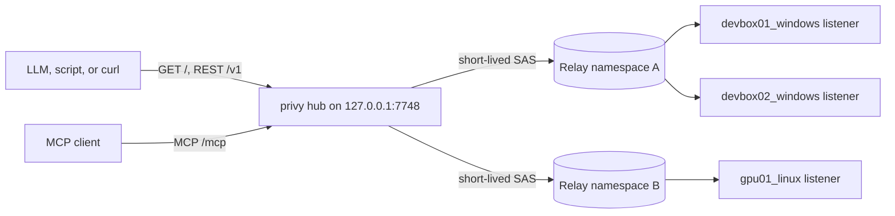

# Hub

`privy hub` is a local control plane for many privy listeners. It runs on your workstation, reads
pre-hydrated Azure Relay keys, and lets you, your scripts, and AI assistants find the machines that
are online and run code on them with live output, as if they were local. It has no authentication:
point an LLM at `http://127.0.0.1:7748/` and it can start working.



The hub never calls Azure Resource Manager. It signs a one-hour SAS token from the hydrated key for
every request, so startup is instant and works without an Azure login.

## Quick start

1. Hydrate keys into the hub's hosting folder with `Sync-PrivyHubRelays.ps1` from
   [Scheduled tasks](SCHEDULED_TASKS.md#1-hydrate-relay-keys), or write [`relays.json`](#relaysjson)
   yourself.
2. Start the hub and check its targets:

   ```powershell
   privy hub serve --home C:\.temp\privy-hub
   privy hub status --home C:\.temp\privy-hub
   ```

3. Tell your AI assistant: _"Read `http://127.0.0.1:7748/` and use it to run commands on my
   machines."_ The page lists the machines online right now with copy-paste examples.
4. Optionally, register the MCP endpoint with Copilot CLI:

   ```powershell
   copilot mcp add --transport http --timeout 180000 privy-hub http://127.0.0.1:7748/mcp
   ```

For an always-on hub, install the `PrivyHub` logon task described in
[Scheduled tasks](SCHEDULED_TASKS.md#2-install-the-hub-task).

## Use it from an LLM

Everything is plain HTTP:

| Step      | Request                                                        | Returns                                                                  |
| --------- | -------------------------------------------------------------- | ------------------------------------------------------------------------ |
| Discover  | `GET /` (also `/llms.txt`)                                     | Markdown: the machines online now, copy-paste examples, rules of thumb.  |
| Run       | `POST /v1/jobs?stream=true&target=<machine>`, the code as body | The command's output, live, between a header line and a trailer line.    |
| Go deeper | `GET /openapi.json`                                            | Every endpoint and parameter, with examples that name an online machine. |

```powershell
curl.exe -sN "http://127.0.0.1:7748/v1/jobs?stream=true&target=devbox01" --data-binary '1..3 | % { Get-Date -Format T; sleep 1 }'
```

```text
[privy] job=9f3c2a1b7d4e target=dev/devbox01_windows language=powershell
11:09:01 AM
11:09:02 AM
11:09:03 AM
[privy] job=9f3c2a1b7d4e state=succeeded exit=0 duration=3.4s
```

- `language` is optional: PowerShell on Windows listeners and Bash elsewhere. Pass `language=python`
  for Python.
- Name a machine by its machine name (`devbox01` for `devbox01_windows`), Hybrid Connection, full
  id, or host name. When a name matches several targets, for example `devbox01_windows` and
  `devbox01_wsl`, the one that is online is used.
- Every `/v1` operation accepts `format=text` for a compact, terminal-like answer instead of JSON.
  The REST-only credentials export at `/v1/relays` is JSON-only.
- Disconnecting from a stream does not stop the job. `GET /v1/jobs/{job_id}/stream` replays its
  output and follows it.
- For multi-line scripts or code with quotes, save the code to a file and send
  `--data-binary '@script.ps1'`. Windows PowerShell 5.1 mangles quotes in arguments to `curl.exe`,
  and keep the quotes around `@script.ps1`: in PowerShell a bare `@` is the splatting operator.

### Latency

Measured from a workstation to a Dev Box over Azure Relay, a stream's header line arrives at once
and each line of output about 0.2 seconds after the remote process writes it. PowerShell 7 holds
back redirected pipeline and `Write-Host` output for roughly another 0.4 seconds;
`[Console]::Out.WriteLine()` output is not delayed. A short command that is not streamed takes about
1.3 seconds end to end.

## Home directory

`--home DIR`, else `PRIVY_HUB_HOME`, else `%LOCALAPPDATA%\privy\hub` on Windows and
`~/.local/state/privy/hub` elsewhere.

| File             | Contents                                                                |
| ---------------- | ----------------------------------------------------------------------- |
| `relays.json`    | Hydrated Relay keys. Override with `--relays-file`. Reloaded on change. |
| `hub-state.json` | URL and process id of the running hub, used by `privy hub status`.      |
| `audit.jsonl`    | One JSON line per command, transfer, and broadcast the hub started.     |

`relays.json` is as sensitive as the Relay keys themselves: anyone who can read it can run code on
every listener. Keep the folder readable only by you. The scripts in
[Scheduled tasks](SCHEDULED_TASKS.md) restrict it automatically. A `hub-token` file left by hub 0.2
is no longer used; delete it at will.

## relays.json

```json
{
  "version": 1,
  "relays": [
    {
      "name": "dev",
      "namespace": "contoso-relay",
      "hybrid_connections": [
        { "path": "devbox01_windows", "keyrule": "all", "key": "<key>" },
        { "path": "devbox02_windows", "keyrule": "all", "key": "<key>" }
      ]
    },
    {
      "name": "lab",
      "namespace": "contoso-lab-relay.servicebus.windows.net",
      "keyrule": "privy-hub-send",
      "key": "<namespace-level key>",
      "hybrid_connections": ["gpu01_linux", { "path": "gpu02_linux", "description": "A100 box" }]
    }
  ]
}
```

| Field                                              | Meaning                                                                                     |
| -------------------------------------------------- | ------------------------------------------------------------------------------------------- |
| `relays[].name`                                    | Prefix of the relay's target ids. Defaults to the namespace's short name. Must be unique.   |
| `relays[].namespace`                               | Relay namespace short name or host name.                                                    |
| `keyrule` and `key`                                | SAS authorization rule and key, on a relay (shared) or a Hybrid Connection (overrides).     |
| `token`                                            | A pre-minted SAS token instead of a key. The hub cannot renew it, so it stops at expiry.    |
| `relays[].hybrid_connections[]`                    | Hybrid Connection names, or objects with `path` plus optional credential and `description`. |
| `subscription_id`, `resource_group`, `hydrated_at` | Informational relay fields written by the hydration script and shown by `list_targets`.     |

The hub re-reads the file when its size or modification time changes. A missing file serves no
targets; an invalid file keeps the last valid relays and reports the error in `list_targets`.

## Targets and status

Each listener is a target with the id `<relay>/<hybrid connection>`, for example
`dev/devbox01_windows`. Operations also accept the bare Hybrid Connection name, the machine name
(the Hybrid Connection name without its `_windows`, `_wsl`, or similar suffix), or the listener's
host name. An ambiguous name resolves to the one matching target that is online, or fails with the
list of candidates.

`list_targets` and `get_target` probe listeners with a side-effect-free `listener_info` request. The
result is cached for 30 seconds (`--probe-ttl-s`); pass `refresh=true` to probe again. Online
targets report `host`, `os`, `user`, `languages`, `privy_version`, `default_language`,
`running_jobs`, and `latency_ms`; `get_target` adds the listener's runtimes and working directory.

| Status         | Meaning                                                                                                        |
| -------------- | -------------------------------------------------------------------------------------------------------------- |
| `online`       | A listener answered. privy 0.2.0+ also reports host, OS, user, version, and runtimes.                          |
| `offline`      | The Hybrid Connection exists but no listener is connected.                                                     |
| `not_found`    | The Hybrid Connection does not exist in the namespace.                                                         |
| `unauthorized` | Azure Relay rejected the key or token. Re-hydrate after rotating keys.                                         |
| `unreachable`  | Azure Relay or the listener did not answer in time, usually while a machine sleeps or its listener reconnects. |
| `error`        | Any other failure; `reason` explains it.                                                                       |
| `unknown`      | Not probed yet (`probe=false`).                                                                                |

Listeners older than privy 0.2.0 answer as `online` with a `details` note instead of host details.
Re-run the listener installer with `-UpdateBinary` to upgrade them.

## REST API

No route needs authentication. `GET /v1` describes the hub as JSON, and `GET /openapi.json` is a
complete OpenAPI 3.1 description with examples.

| Method and path                     | Operation                                                                    |
| ----------------------------------- | ---------------------------------------------------------------------------- |
| `GET /` and `GET /llms.txt`         | Quickstart (Markdown) with the machines online now; `/` serves browsers HTML |
| `GET /ui`                           | Dashboard (HTML); see [Dashboard](#dashboard)                                |
| `GET /v1/stats`                     | Usage metrics per HYCO from the hub's memory (`range` = `1h`, `24h`, `7d`)   |
| `GET /v1/relays`                    | Export normalized Relay credentials per target (sensitive JSON; REST only)   |
| `GET /v1/targets`                   | `list_targets` (`refresh`, `online_only`, `relay`, `probe`)                  |
| `GET /v1/targets/{target}`          | `get_target`                                                                 |
| `POST /v1/jobs`                     | `run`; `stream=true` streams the output                                      |
| `GET /v1/jobs`                      | `list_jobs`                                                                  |
| `GET /v1/jobs/{job_id}`             | `get_job` (`wait_s`, `max_output_bytes`, `stdout_offset`, `stderr_offset`)   |
| `GET /v1/jobs/{job_id}/stream`      | The job's output from the start, then live until it finishes                 |
| `GET /v1/jobs/{job_id}/output`      | `read_job_output` (`stream`, `offset`, `limit`)                              |
| `POST /v1/jobs/{job_id}/cancel`     | `cancel_job`                                                                 |
| `POST /v1/broadcasts`               | `broadcast`                                                                  |
| `GET /v1/broadcasts/{broadcast_id}` | `get_broadcast`                                                              |
| `POST /v1/files/upload`             | `upload_file`                                                                |
| `POST /v1/files/download`           | `download_file`                                                              |
| `POST /v1/files/sync`               | `sync_files`: async file/folder contents update (REST only; 202 + job URL)   |

Arguments go in the query string, in a JSON body (`Content-Type: application/json`), or both. For
`POST /v1/jobs` and `POST /v1/broadcasts`, putting `target` (or `targets`) in the query string makes
the raw request body the code: the easiest form to type in a shell. `targets` takes comma-separated
glob patterns. Errors use `{"error": {"code": "...", "message": "..."}}` with an HTTP 4xx/5xx
status, or `error (<code>): <message>` with `format=text`.

```powershell
$hub = "http://127.0.0.1:7748"
Invoke-RestMethod "$hub/v1/targets?online_only=true&format=text"

$job = Invoke-RestMethod -Method Post "$hub/v1/jobs?target=devbox01&wait_s=5" -Body 'Get-ChildItem C:\'
Invoke-RestMethod "$hub/v1/jobs/$($job.job_id)?wait_s=60"
```

### Dashboard

Open `http://127.0.0.1:7748/` (or `/ui`) in a browser for the hub's control plane. Clients that
don't ask for `text/html` still get the Markdown quickstart at `/`.

| Page        | Shows                                                                                        |
| ----------- | -------------------------------------------------------------------------------------------- |
| `/ui`       | Key numbers (jobs, success rate, latency, bytes moved), activity over time, busiest HYCOs    |
| `/ui/hycos` | Every relay HYCO with job counts, a sparkline over the chosen range, status, and last use    |
| `/ui/jobs`  | Recent jobs, filterable by `state`                                                           |
| `/ui/logs`  | Per-HYCO commands and output as collapsible terminals, like `kubectl logs`; live jobs follow |

Add `?range=1h`, `24h`, or `7d` to change the window. `GET /ui/jobs/{job_id}/log` returns one job's
command and output as plain text. `GET /v1/stats` returns the same numbers as JSON.

Everything is kept in the hub's memory and is lost on restart. Each job keeps its command and up to
its output buffer limit (older output is trimmed). On startup the hub rebuilds job history (without
output) from `audit.jsonl`. Memory grows with the number of jobs until the hub restarts.

### Export Relay credentials

`GET /v1/relays` returns the effective credentials for every configured target, including offline
listeners. It reads the same validated configuration as the hub: `HOME\relays.json` unless
`--relays-file` overrides it. It does not probe listeners, call Azure, or mint tokens.

```powershell
Invoke-RestMethod "http://127.0.0.1:7748/v1/relays"
```

```json
{
  "targets": [
    {
      "id": "dev/devbox01_windows",
      "relay": "dev",
      "namespace": "contoso-relay",
      "path": "devbox01_windows",
      "keyrule": "all",
      "key": "<key>"
    }
  ],
  "stale": false
}
```

Namespace-level credentials are inherited, and per-connection credentials override them. Each entry
contains either `keyrule` and `key` or `token`, never both. Raw file metadata is not included. This
endpoint is JSON-only (`format=json` is optional), supports `HEAD`, and is not an MCP tool.

If the file becomes invalid, unreadable, or missing after a successful load, this endpoint serves
the last valid credentials with `stale: true` and a `warning`. Cached keys may have been revoked,
and cached tokens may have expired. A valid empty configuration replaces the cache with no targets.
Before any valid configuration has loaded, the endpoint returns HTTP 503 with error code
`credentials_unavailable`. Ordinary target/job behavior is unchanged: a missing file still removes
targets from normal operations.

**The response contains secrets**, is sent with `Cache-Control: no-store`, and is never logged by
the hub. Do not paste it into chats, logs, or source control. Exported long-lived keys can retain
access after the hub stops.

### Live streams

`stream=true` on `POST /v1/jobs` or `GET /v1/jobs/{job_id}`, and `GET /v1/jobs/{job_id}/stream`,
answer with chunked `text/plain`:

1. `[privy] job=<id> target=<target id> language=<language>`
2. stdout and stderr as they arrive, interleaved in arrival order
3. `[privy] job=<id> state=<state> exit=<code> duration=<seconds>s`, plus `error=` when the hub
   could not run the job

Use `curl -N` so curl writes each chunk at once. When the hub no longer holds the beginning of a
very long job's output, a `[privy] ... no longer kept by the hub` line marks the gap.

## MCP

`POST /mcp` is a Streamable HTTP MCP endpoint. It serves both protocol generations on the same URL:

- **2026-07-28** clients send the protocol version on every request and may call `server/discover`.
  The hub validates the `MCP-Protocol-Version`, `Mcp-Method`, and `Mcp-Name` headers.
- **2025-11-25, 2025-06-18, and 2025-03-26** clients open with `initialize`. The hub needs no
  session, so it never issues `Mcp-Session-Id`.

Each job/target REST operation is also a tool except file sync; sync and credential export are
REST-only. The server returns usage instructions for the model. Tool results carry a compact text
rendering as `content`, which is what the model reads, and the JSON as `structuredContent`.

| Tool                           | Purpose                                                         |
| ------------------------------ | --------------------------------------------------------------- |
| `list_targets`, `get_target`   | Discover machines, their status, and listener details.          |
| `run`                          | Run PowerShell, Bash, or Python on one target.                  |
| `get_job`, `read_job_output`   | Follow a job's new output, or page through all of it by offset. |
| `cancel_job`, `list_jobs`      | Stop a job or review recent ones.                               |
| `broadcast`, `get_broadcast`   | Run the same code on every matching target in parallel.         |
| `upload_file`, `download_file` | Copy files between this machine and a target.                   |

A `tools/call` of `run`, `get_job`, `broadcast`, `get_broadcast`, `upload_file`, or `download_file`
that carries `_meta.progressToken`, from a client that accepts `text/event-stream`, is answered as a
Server-Sent Events stream: `notifications/progress` messages with the newest output line (at most
four per second, and a heartbeat every 10 seconds of silence) while the call waits, then the result.

Register the endpoint with Copilot CLI. `--timeout` is in milliseconds and must exceed the longest
`wait_s` (120 seconds):

```powershell
copilot mcp add --transport http --timeout 180000 privy-hub http://127.0.0.1:7748/mcp
```

Or add this to `~/.copilot/mcp-config.json`:

```json
{
  "mcpServers": {
    "privy-hub": {
      "type": "http",
      "url": "http://127.0.0.1:7748/mcp",
      "timeout": 180000,
      "tools": ["*"]
    }
  }
}
```

A registration made for hub 0.2 still works, because the hub ignores its `Authorization` header. To
drop the header, run `copilot mcp remove privy-hub` and add the server again.

## Jobs

`run` starts a job and waits up to `wait_s` seconds (default 30, maximum 120). A finished job
returns its exit code and output. Otherwise `state` is `running` and `next_step` says to call
`get_job`, which waits again and returns only the output produced since the previous `run` or
`get_job` answer for that job. `stdout_offset` and `stderr_offset` mark where an answer stopped;
pass them back to read from there again. The remote command keeps running in all cases, up to its
own `timeout_s` (default 600).

| State       | Meaning                                                          |
| ----------- | ---------------------------------------------------------------- |
| `queued`    | Waiting for one of the `--max-jobs` (default 32) slots.          |
| `running`   | Executing on the target.                                         |
| `succeeded` | Exit code 0.                                                     |
| `failed`    | Non-zero exit code, or the listener rejected the request.        |
| `timed_out` | The remote process tree was killed at `timeout_s`.               |
| `cancelled` | Stopped by `cancel_job`.                                         |
| `error`     | The hub could not run it; `error` starts with the target status. |

Each answer carries at most `max_output_bytes` (default 16 KiB) of new stdout and of new stderr, the
newest part, with `stdout_skipped_bytes` or `stderr_skipped_bytes` when older bytes were left out.
`read_job_output` pages through the most recent 1 MiB of each stream by byte offset. Finished jobs
are kept for one hour (up to 200). Jobs live in hub memory, so restarting the hub forgets them while
the remote commands run to completion.

`broadcast` matches glob patterns against target ids (`dev/*`) or Hybrid Connection names
(`*_windows`), skips targets that are not online, and starts one job per remaining target in that
target's default language unless `language` is given. `get_broadcast` waits for the rest.

`upload_file` and `download_file` run as jobs too. Local paths must be absolute paths on the hub
machine; remote relative paths resolve against the listener's working directory. Transfers are
resumable and SHA-256 verified, and they refuse to replace a destination unless `overwrite` is true.

### Sync a local file or folder into a target

`POST /v1/files/sync` creates a **sync job** and returns **202 Accepted** with
`Location: /v1/jobs/<job_id>`. Paths refer to the hub's filesystem and the listener's filesystem,
not to the HTTP caller's machine. This endpoint is REST-only; it uses the existing listener's Python
execution and resumable, SHA-256-verified upload, with no listener upgrade required. Remote
preparation uses the listener's embedded Python in an isolated namespace, so a frozen Windows
listener does not need an external `python.exe` installation.

| Argument           | Required | Meaning                                                                                                          |
| ------------------ | -------- | ---------------------------------------------------------------------------------------------------------------- |
| `target`           | Yes      | Machine name, Hybrid Connection, full target id, or host name.                                                   |
| `local_path`       | Yes      | Absolute file or directory on the hub machine.                                                                   |
| `remote_path`      | Yes      | Absolute destination using the target's path syntax.                                                             |
| `destination_type` | Yes      | `directory` or `file`; deliberately no implicit guessing.                                                        |
| `overwrite`        | No       | Default `true`: replace differing files. `false` fails on a differing existing file; identical files still skip. |

With `destination_type=directory`, a source directory's **contents** go directly under `remote_path`
(not an extra source folder); a single source file goes to `remote_path\<source filename>`. With
`destination_type=file`, the source must be a single file and `remote_path` is its exact destination
filename, allowing renaming.

```powershell
$hub = "http://127.0.0.1:7748"
$body = @{
    target = "dev/raki-windows-8_windows"
    local_path = "C:\data\my-project"
    remote_path = "C:\.temp\my-project"
    destination_type = "directory"
} | ConvertTo-Json

$job = Invoke-RestMethod -Method Post "$hub/v1/files/sync" -ContentType "application/json" -Body $body
Invoke-RestMethod "$hub/v1/jobs/$($job.job_id)?wait_s=60"
Invoke-RestMethod -Method Post "$hub/v1/jobs/$($job.job_id)/cancel"
```

To copy and rename one file:

```powershell
$body = @{
    target = "dev/raki-windows-8_windows"
    local_path = "C:\data\settings.json"
    remote_path = "C:\.temp\my-project\appsettings.json"
    destination_type = "file"
} | ConvertTo-Json
Invoke-RestMethod -Method Post "$hub/v1/files/sync" -ContentType "application/json" -Body $body
```

For curl, save the JSON to `sync.json`, then send it without PowerShell argument-quoting issues:

```powershell
curl.exe -i -s -H "Content-Type: application/json" --data-binary '@sync.json' http://127.0.0.1:7748/v1/files/sync
```

The initial response uses the normal job shape; a completed example is:

```json
{
  "job_id": "9f3c2a1b7d4e",
  "target": "dev/raki-windows-8_windows",
  "type": "sync",
  "state": "succeeded",
  "done": true,
  "exit_code": 0,
  "local_path": "C:\\data\\my-project",
  "remote_path": "C:\\.temp\\my-project",
  "destination_type": "directory",
  "progress": {
    "phase": "completed",
    "files_total": 3,
    "files_done": 3,
    "files_copied": 1,
    "files_skipped": 2,
    "directories_total": 2,
    "bytes_total": 300,
    "bytes_done": 300,
    "bytes_copied": 100,
    "current_path": null
  },
  "result": {
    "phase": "completed",
    "files_total": 3,
    "files_done": 3,
    "files_copied": 1,
    "files_skipped": 2,
    "directories_total": 2,
    "bytes_total": 300,
    "bytes_done": 300,
    "bytes_copied": 100,
    "current_path": null
  }
}
```

- Poll the returned job id until `done=true`; the initial response can already be terminal for tiny
  jobs. `phase` progresses through `queued`, `scanning`, `preparing`, `uploading`, and `completed`.
  Queued jobs may have only the phase; totals become available after local scanning.
- Missing directories (including parents) and empty source directories are created. Hidden files are
  included; there are no implicit excludes, so avoid syncing entire repositories containing secrets
  unless that is intentional.
- Identical files are compared using SHA-256 and skipped without uploading their contents.
  Remote-only files are **never deleted**. This is a one-shot copy/update, not a mirror or watcher.
- Updated listeners keep completed-upload receipts in private state, not destination folders. Sync
  also migrates valid legacy `.complete` receipts for identical files it skips. Upgrade the listener
  to enable this cleanup; interrupted `.part` uploads remain resumable.
- `files_done` counts completed copies plus skips. `bytes_done` includes the sizes of skipped files
  plus current upload progress; `bytes_copied` counts completed uploaded file payloads, not network
  overhead. File timestamps, ACLs, and permissions are not preserved.
- Source trees are bounded to **10,000 entries** (files plus directories, including the root
  directory) and **1 MiB serialized manifest JSON**. File contents are hashed/transferred in bounded
  chunks, not loaded wholly into memory. Paths are limited to 4,096 characters at the API.
- Symlinks, Windows junctions/reparse points, special files, incompatible destination names, case
  collisions on Windows, and file/directory conflicts are rejected. Do not concurrently modify
  either tree: this is not a filesystem snapshot or an atomic tree transaction.
- Basic argument/source errors return HTTP 400/404; unknown targets return 404 and a full queue
  returns 429. Enumeration, remote path, link, comparison, transfer, or source-mutation errors after
  acceptance produce a failed/error job with `error` and partial progress/result.
- Cancellation is best effort: it interrupts the remote preparation command or checks local
  scanning/chunk/between-file boundaries. It may wait for an in-flight hash or Relay request. Remote
  directory/hash preparation has a 600-second execution limit.
- On failure/cancellation, already completed files and created directories remain; matching partial
  uploads can resume on a later request. There is no rollback and no automatic retry. Poll/cancel
  works after the initial HTTP connection closes; jobs themselves remain in memory under the normal
  hub retention policy.
- `format=text` is supported for submission and polling. Submission is always asynchronous (no
  `wait_s` argument); use the existing job endpoint's `wait_s` for long polling.

## Console

Like `privy server`, the hub shows everything it does in its console:

- one line per probe, for example
  `probe dev/devbox01_windows: online 412ms host=DEVBOX01 privy=0.3.0`
- a `▶ RUN` box per command, and `▶ UPLOAD` or `▶ DOWNLOAD` per transfer: relay, namespace, Hybrid
  Connection, host, origin (`rest` or `mcp`), language, timeout, and the code
- the command's output as it arrives, prefixed with the job id and Hybrid Connection, for example
  `[9f3c2a1b devbox01_windows] 11:09:01 AM`
- a `◀ RESULT` box: state, exit code, duration, remote job id, and the tail of stdout and stderr
- one line per REST or MCP call with its arguments, HTTP status, and duration

`--no-echo-output` (or `PRIVY_ECHO_OUTPUT=0`) hides the live output lines. `-vv` adds one line per
Relay request.

## Security

- The hub has no authentication. Native processes on this machine can run code on every listener
  with the listener account's privileges and export Relay credentials. Run the hub only on a
  workstation that you alone use.
- Every route (REST, MCP, discovery, health, and streams) requires exactly one `Host` header naming
  `127.0.0.1`, `localhost`, or `[::1]` on the hub's actual port. Supplied `Origin` headers must
  match the exact HTTP origin, including host and port. Untrusted, missing, malformed, or duplicate
  Host headers, invalid/duplicate/cross-origin Origin headers, and browser requests marked
  `Sec-Fetch-Site: cross-site` are rejected with HTTP 403 before dispatch.
- These checks block DNS rebinding and cross-origin browser requests, not local native clients that
  can forge headers. Open `http://127.0.0.1:7748/` directly in your browser; local curl and MCP
  clients work without Origin headers. Different hostnames, other local browser application ports,
  and remote URLs are deliberately not allowed. No CORS permissions are granted.
- It binds to `127.0.0.1` by default. `--host` with another address exposes remote execution to
  anyone who can reach that address and forge local headers; the hub warns at startup. Binding more
  widely does not relax the Host/Origin policy.
- Keys stay out of normal API responses, discovery documents, and MCP tools. Only the explicit REST
  credentials export returns keys/tokens; its response is never logged. Each Relay request normally
  uses a freshly minted one-hour SAS token (or the configured pre-minted token).
- `audit.jsonl` records each job's target, origin (`rest` or `mcp`), language, the first 4 KiB of
  code with its SHA-256, and the outcome.
- Approve `run`, `broadcast`, and transfers in your MCP client unless you trust what it will do.

## Troubleshooting

| Symptom                         | Fix                                                                             |
| ------------------------------- | ------------------------------------------------------------------------------- |
| No targets                      | Hydrate `relays.json` in the hub home; check `relays_file.error` in the output. |
| `unauthorized`                  | The key was rotated or the rule removed. Re-run the hydration script.           |
| `offline` everywhere            | The listener tasks are not running on those machines.                           |
| `not_found`                     | The Hybrid Connection was deleted. Re-hydrate to drop it.                       |
| `target ... is ambiguous`       | Use one of the listed ids, or the full `<relay>/<hybrid connection>` id.        |
| A stream prints nothing         | Add `-N` to curl. Without it, curl may buffer the output until the job ends.    |
| `cannot start the hub ... 7748` | Another process uses the port. Pass `--port` and update the MCP registration.   |
| Copilot does not list the tools | Check `copilot mcp list`, then `privy hub status`, then the hub console.        |
