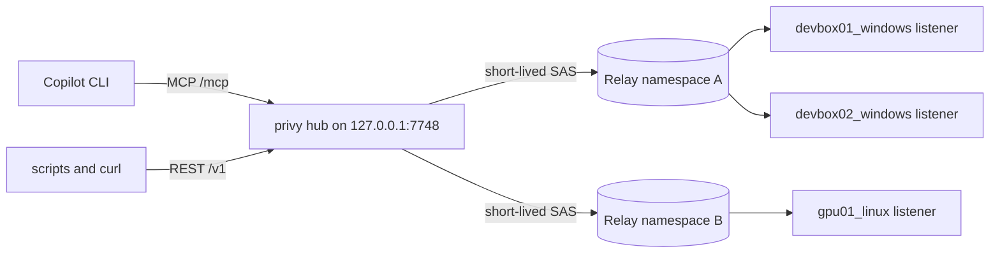

# Hub

`privy hub` is a local control plane for many privy listeners. It runs on your workstation, reads
pre-hydrated Azure Relay keys, probes which listeners are online, and runs code or copies files on
any of them. You, your scripts, and AI assistants such as GitHub Copilot reach it through a loopback
REST API and a Model Context Protocol (MCP) endpoint.



The hub never calls Azure Resource Manager. It signs a one-hour SAS token from the hydrated key for
every request, so startup is instant and works without an Azure login.

## Quick start

1. Hydrate keys into the hub's hosting folder with `Sync-PrivyHubRelays.ps1` from
   [Scheduled tasks](SCHEDULED_TASKS.md#1-hydrate-relay-keys), or write [`relays.json`](#relaysjson)
   yourself.
2. Start the hub and check its targets:

   ```powershell
   privy hub serve --home C:\.temp\privy-hub
   privy hub status --home C:\.temp\privy-hub
   ```

3. Register it with Copilot CLI:

   ```powershell
   copilot mcp add --transport http `
       --header "Authorization: Bearer $((Get-Content 'C:\.temp\privy-hub\hub-token').Trim())" `
       privy-hub http://127.0.0.1:7748/mcp
   ```

For an always-on hub, install the `PrivyHub` logon task described in
[Scheduled tasks](SCHEDULED_TASKS.md#2-install-the-hub-task).

## Home directory

`--home DIR`, else `PRIVY_HUB_HOME`, else `%LOCALAPPDATA%\privy\hub` on Windows and
`~/.local/state/privy/hub` elsewhere.

| File             | Contents                                                                  |
| ---------------- | ------------------------------------------------------------------------- |
| `relays.json`    | Hydrated Relay keys. Override with `--relays-file`. Reloaded on change.   |
| `hub-token`      | Bearer token for the API, generated on first start and reused afterwards. |
| `hub-state.json` | URL and process id of the running hub, used by `privy hub status`.        |
| `audit.jsonl`    | One JSON line per command, transfer, and broadcast the hub started.       |

`relays.json` and `hub-token` are as sensitive as the Relay keys themselves: anyone who can read
them can run code on every listener. Keep the folder readable only by you. The scripts in
[Scheduled tasks](SCHEDULED_TASKS.md) restrict it automatically.

## relays.json

```json
{
  "version": 1,
  "relays": [
    {
      "name": "dev",
      "namespace": "contoso-relay",
      "hybrid_connections": [
        { "path": "devbox01_windows", "keyrule": "all", "key": "<key>" },
        { "path": "devbox02_windows", "keyrule": "all", "key": "<key>" }
      ]
    },
    {
      "name": "lab",
      "namespace": "contoso-lab-relay.servicebus.windows.net",
      "keyrule": "privy-hub-send",
      "key": "<namespace-level key>",
      "hybrid_connections": ["gpu01_linux", { "path": "gpu02_linux", "description": "A100 box" }]
    }
  ]
}
```

| Field                                              | Meaning                                                                                     |
| -------------------------------------------------- | ------------------------------------------------------------------------------------------- |
| `relays[].name`                                    | Prefix of the relay's target ids. Defaults to the namespace's short name. Must be unique.   |
| `relays[].namespace`                               | Relay namespace short name or host name.                                                    |
| `keyrule` and `key`                                | SAS authorization rule and key, on a relay (shared) or a Hybrid Connection (overrides).     |
| `token`                                            | A pre-minted SAS token instead of a key. The hub cannot renew it, so it stops at expiry.    |
| `relays[].hybrid_connections[]`                    | Hybrid Connection names, or objects with `path` plus optional credential and `description`. |
| `subscription_id`, `resource_group`, `hydrated_at` | Informational relay fields written by the hydration script and shown by `list_targets`.     |

The hub re-reads the file when its size or modification time changes. A missing file serves no
targets; an invalid file keeps the last valid relays and reports the error in `list_targets`.

## Targets and status

Each listener is a target named `<relay>/<hybrid connection>`, for example `dev/devbox01_windows`. A
bare Hybrid Connection name also works when it is unique across relays.

`list_targets` and `get_target` probe listeners with a side-effect-free `listener_info` request. The
result is cached for 30 seconds (`--probe-ttl-s`); pass `refresh=true` to probe again.

| Status         | Meaning                                                                                                        |
| -------------- | -------------------------------------------------------------------------------------------------------------- |
| `online`       | A listener answered. privy 0.2.0+ also reports host, OS, user, version, and runtimes.                          |
| `offline`      | The Hybrid Connection exists but no listener is connected.                                                     |
| `not_found`    | The Hybrid Connection does not exist in the namespace.                                                         |
| `unauthorized` | Azure Relay rejected the key or token. Re-hydrate after rotating keys.                                         |
| `unreachable`  | Azure Relay or the listener did not answer in time, usually while a machine sleeps or its listener reconnects. |
| `error`        | Any other failure; `error` explains it.                                                                        |
| `unknown`      | Not probed yet (`probe=false`).                                                                                |

Listeners older than privy 0.2.0 answer as `online` with `details_available: false`. Re-run the
listener installer with `-UpdateBinary` to upgrade them.

## REST API

Every route except `/healthz` requires `Authorization: Bearer <hub-token>`. `GET /v1` describes the
hub, and `GET /openapi.json` is a complete OpenAPI 3.1 description.

| Method and path                     | Operation                                          |
| ----------------------------------- | -------------------------------------------------- |
| `GET /v1/targets`                   | `list_targets` (`refresh`, `online_only`, `relay`) |
| `GET /v1/targets/{target}`          | `get_target`                                       |
| `POST /v1/jobs`                     | `run`                                              |
| `GET /v1/jobs`                      | `list_jobs`                                        |
| `GET /v1/jobs/{job_id}`             | `get_job` (`wait_s`, `max_output_bytes`)           |
| `GET /v1/jobs/{job_id}/output`      | `read_job_output` (`stream`, `offset`, `limit`)    |
| `POST /v1/jobs/{job_id}/cancel`     | `cancel_job`                                       |
| `POST /v1/broadcasts`               | `broadcast`                                        |
| `GET /v1/broadcasts/{broadcast_id}` | `get_broadcast`                                    |
| `POST /v1/files/upload`             | `upload_file`                                      |
| `POST /v1/files/download`           | `download_file`                                    |

`GET` routes take query parameters and `POST` routes take a JSON body. Errors use
`{"error": {"code": "...", "message": "..."}}` with an HTTP 4xx status.

```powershell
$hub = "http://127.0.0.1:7748"
$headers = @{ Authorization = "Bearer $((Get-Content 'C:\.temp\privy-hub\hub-token').Trim())" }

Invoke-RestMethod "$hub/v1/targets?online_only=true" -Headers $headers

$body = @{ target = "dev/devbox01_windows"; language = "powershell"; code = "Get-Date" } | ConvertTo-Json
$job = Invoke-RestMethod "$hub/v1/jobs" -Method Post -Headers $headers -ContentType application/json -Body $body
Invoke-RestMethod "$hub/v1/jobs/$($job.job_id)?wait_s=60" -Headers $headers
```

## MCP

`POST /mcp` is a Streamable HTTP MCP endpoint that answers with JSON. It serves both protocol
generations on the same URL:

- **2026-07-28** clients send the protocol version on every request and may call `server/discover`.
  The hub validates the `MCP-Protocol-Version`, `Mcp-Method`, and `Mcp-Name` headers.
- **2025-11-25, 2025-06-18, and 2025-03-26** clients open with `initialize`. The hub needs no
  session, so it never issues `Mcp-Session-Id`.

Each REST operation is also a tool, and the server returns usage instructions for the model:

| Tool                           | Purpose                                                            |
| ------------------------------ | ------------------------------------------------------------------ |
| `list_targets`, `get_target`   | Discover machines, their status, and listener details.             |
| `run`                          | Run Python, Bash, or PowerShell on one target.                     |
| `get_job`, `read_job_output`   | Wait for a job and read its output tail or page through all of it. |
| `cancel_job`, `list_jobs`      | Stop a job or review recent ones.                                  |
| `broadcast`, `get_broadcast`   | Run the same code on every matching target in parallel.            |
| `upload_file`, `download_file` | Copy files between this machine and a target.                      |

To configure Copilot CLI by file instead of `copilot mcp add`, add this to
`~/.copilot/mcp-config.json`:

```json
{
  "mcpServers": {
    "privy-hub": {
      "type": "http",
      "url": "http://127.0.0.1:7748/mcp",
      "headers": { "Authorization": "Bearer <contents of hub-token>" },
      "tools": ["*"]
    }
  }
}
```

## Jobs

`run` starts a job and waits up to `wait_s` seconds (default 20, maximum 120). A finished job
returns its result; otherwise `state` is `running` and `next_step` says to call `get_job`, which
waits again. The remote command keeps running in both cases, up to its own `timeout_s` (default
600).

| State       | Meaning                                                          |
| ----------- | ---------------------------------------------------------------- |
| `queued`    | Waiting for one of the `--max-jobs` (default 32) slots.          |
| `running`   | Executing on the target.                                         |
| `succeeded` | Exit code 0.                                                     |
| `failed`    | Non-zero exit code, or the listener rejected the request.        |
| `timed_out` | The remote process tree was killed at `timeout_s`.               |
| `cancelled` | Stopped by `cancel_job`.                                         |
| `error`     | The hub could not run it; `error` starts with the target status. |

Results carry the last `max_output_bytes` (default 16 KiB) of stdout and stderr, the full sizes in
`stdout_bytes`/`stderr_bytes`, and `*_truncated` flags. `read_job_output` pages through the most
recent 1 MiB of each stream by byte offset. Finished jobs are kept for one hour (up to 200). Jobs
live in hub memory, so restarting the hub forgets them while the remote commands run to completion.

`broadcast` matches glob patterns against target ids (`dev/*`) or Hybrid Connection names
(`*_windows`), skips targets that are not online, and starts one job per remaining target.
`get_broadcast` waits for the rest.

`upload_file` and `download_file` run as jobs too. Local paths must be absolute paths on the hub
machine; remote relative paths resolve against the listener's working directory. Transfers are
resumable and SHA-256 verified, and they refuse to replace a destination unless `overwrite` is true.

## Security

- The hub binds to `127.0.0.1` and rejects requests whose `Host` is not its loopback address,
  blocking DNS-rebinding attacks.
- Requests carrying an `Origin` header (browsers) are refused unless allowed with `--allow-origin`.
  Allowed origins receive CORS headers, including answers to preflight requests.
- Every route except `/healthz` needs the bearer token from `hub-token`, compared in constant time.
- Keys stay in `relays.json` and hub memory. They are never returned by the API or MCP tools and
  never logged; each Relay request uses a freshly minted one-hour SAS token.
- `audit.jsonl` records each job's target, origin (`rest` or `mcp`), language, the first 4 KiB of
  code with its SHA-256, and the outcome.
- Commands run with the listener account's privileges. Approve `run`, `broadcast`, and transfers in
  your MCP client unless you trust every caller of the hub.

## Troubleshooting

| Symptom                         | Fix                                                                             |
| ------------------------------- | ------------------------------------------------------------------------------- |
| No targets                      | Hydrate `relays.json` in the hub home; check `relays_file.error` in the output. |
| `unauthorized`                  | The key was rotated or the rule removed. Re-run the hydration script.           |
| `offline` everywhere            | The listener tasks are not running on those machines.                           |
| `not_found`                     | The Hybrid Connection was deleted. Re-hydrate to drop it.                       |
| `cannot start the hub ... 7748` | Another process uses the port. Pass `--port` and update the MCP registration.   |
| Copilot does not list the tools | Check `copilot mcp list`, the token in the header, and `privy hub status`.      |
