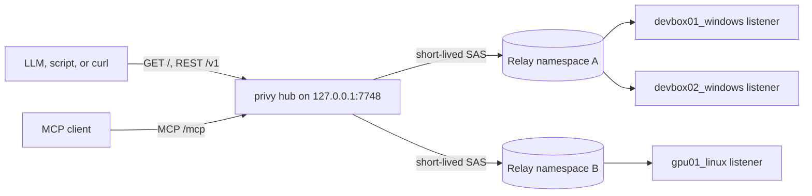

# Hub

`privy hub` is a local control plane for many privy listeners. It runs on your workstation, reads
pre-hydrated Azure Relay keys, and lets you, your scripts, and AI assistants find the machines that
are online and run code on them with live output, as if they were local. It has no authentication:
point an LLM at `http://127.0.0.1:7748/` and it can start working.



The hub never calls Azure Resource Manager. It signs a one-hour SAS token from the hydrated key for
every Relay request. The default file-backed mode works without an Azure login; optional Azure SQL
mode uses Azure CLI authentication for its shared backing store.

## Shared Azure SQL backing store

Install `privy[sql]`, Microsoft **ODBC Driver 18 for SQL Server**, and Azure CLI on each hub
machine. Sign in with `az login` as an identity authorized in the database. The application uses
`azure.identity.AzureCliCredential` explicitly, caches its access token and refreshes it five
minutes before expiry. Connections require encryption and validate the server certificate. The
driver and Azure CLI remain machine prerequisites, not components bundled into `privy.exe`.

Copy `appsettings.template.yaml` to a **local, gitignored** `appsettings.yaml`, set `storage.server`
and `storage.database`, and hydrate identical target names/namespaces and `leases.yaml` rules in
each hub home. Relay keys remain local and need not be committed or sent to SQL.

```yaml
version: 1
storage:
  mode: azure_sql
  server: YOUR-SERVER.database.windows.net
  database: privy
  driver: ODBC Driver 18 for SQL Server
  retention_days: 7
  outbox_max_bytes: 268435456
```

Start each hub explicitly with its own home, for example:

```powershell
privy hub serve --home C:\privy-shared-home --settings C:\privy-local\appsettings.yaml --port 17749
```

Settings resolution is `--settings`, then `PRIVY_HUB_SETTINGS`, then `<home>\appsettings.yaml`, then
the current directory's `appsettings.yaml`. Without any settings, existing file behavior is
unchanged. Explicitly selected missing files, invalid settings, SQL authentication/connection
failures and conflicting shared configurations are errors: **they never fall back to independent
file leasing**. To deliberately choose file mode, use `version: 1` and `storage: {mode: file}`.

Startup bootstraps versioned SQL tables under a transaction-owned SQL application lock. Concurrent
starts are safe. SQL is authoritative for clients, leases, use/cooldown records and job pins: each
operation reads current keyed records inside a database transaction, uses database time and commits
only changed records. Admission, session registration, holder checks, renewal, client limits and
release therefore coordinate across hubs. A differing target topology or lease/storage configuration
is rejected; hydrate the complete intended topology before the first SQL start. Legacy lease rows
are compared using the current duration/default rules and accepted only when their effective values
match exactly. They are left in their original representation so an older running hub remains
compatible; a real policy difference still blocks startup.

The deployed `privy-sql.database.windows.net` permits all client IPs through the single
`privy-allow-all` rule. No per-machine firewall setup is needed. This makes the SQL endpoint
internet-reachable; Entra-only authentication and TLS 1.2 remain required.

Job workers stay on their originating hub. Shared job summaries, output pages, broadcasts, audit,
listener facts, purposes and dashboard telemetry are journaled locally before asynchronous delivery
to SQL. The bounded SQLite delivery journal uses full durability, ordered replay and SQL
owner/revision checks. It is **not** a second leasing authority. Outages retain pending deliveries;
full journals reject new writes and report errors/backpressure rather than dropping old data. Keep
each home and its `sql-outbox.sqlite3` files until all pending deliveries have been flushed.

Legacy `audit.jsonl` cutover runs in a background thread, scanning at most its last 64 MiB and seven
days of job starts/finishes. It checks existing job and deterministic audit keys in bulk, then
commits missing records in insert-only SQL batches of at most 500, without flooding the live
delivery journal or replacing shared jobs. Interrupted imports resume from already committed keys.
The file's SHA-256 completion marker is committed only after every import batch is durable and the
source is verified unchanged; an unchanged completed file needs only hashing and one marker lookup
on restart. An existing journal must drain before migration begins. Failures remain visible in
storage health and can be retried on restart. Successfully imported or already-completed, unchanged
files are renamed to `audit.jsonl.imported-snapshot`; existing snapshots are preserved.

Either hub can inspect/follow shared jobs and request cancellation. Cancellation is durably recorded
in SQL and only acknowledged by the executing hub after it processes the request. Acceptance does
not promise immediate cancellation while that owner is offline. A same-home successor fences the
previous SQL incarnation but neither restarts its work nor clears its pins. **Stale heartbeats do
not prove remote execution stopped.** Normal release refuses while leased jobs are pinned; the
explicit force-release action can reconcile pins only after every owner is marked stopped, stale, or
unresolved file import. Verify remote work has ended before using it, because reconciliation may
make the box available while remote work continues. Unleased running jobs also keep their group
unavailable for fresh lease admission.

SQL is authoritative for lease policy. A missing `leases.yaml` is hydrated from the shared policy;
an existing local policy does not override SQL. Target configuration comparisons ignore ordering,
but still reject different target identities, namespaces or paths.

If a SQL-enabled home contains `leases-state.json`, startup imports missing records under the same
SQL lock and keeps existing SQL identities, allocations and pins unchanged. Historical local clients
with a matching shared session use the canonical SQL client ID. An active or pinned local allocation
that would require changing its owner is rejected rather than silently reassigned. Equivalent/newer
shared records do not block restart. Successful imports are retired to
`leases-state.json.imported-snapshot`, preserving prior snapshots. Imports never access another
home. Newly imported released/expired pinned work is rejected until that unresolved work has been
checked. Local PID discovery files, Relay secrets, sockets, interactive terminal sessions and
hub-local transfer paths do not migrate through SQL. Metadata is shared; files and interactive
resources still belong to the machine hosting them.

### Fresh-home recovery and planned cutovers

A new home with regenerated `relays.json` and SQL `appsettings.yaml` reads the same shared clients,
leases, jobs/output/history, listener facts and dashboard telemetry. Its newly generated
`.sql-hub-id` does not partition shared reads or transfer ownership of another hub's running work.
SQL `restored_jobs` counts SQL-loaded report entries consistently across hubs; process uptime and
owner-local execution/terminal capabilities still describe the current process.

| Home file                                    | SQL-mode recovery role                                                                |
| -------------------------------------------- | ------------------------------------------------------------------------------------- |
| `relays.json`, `appsettings.yaml`            | Local connection/secret configuration; regenerate securely, not stored in SQL.        |
| `leases.yaml`                                | SQL policy is authoritative; missing file is hydrated.                                |
| `leases-state.json`, `audit.jsonl`           | Optional legacy migration inputs, retired after successful durable import.            |
| `listener-info-state.json`                   | File-mode only; SQL listener facts are read from shared storage.                      |
| `.sql-hub-id`, `sql-home.lock`               | Local incarnation/fencing and exclusive-home coordination, regenerated on a new home. |
| `hub-state.json`, legacy `hub-token`         | Local PID/URL discovery and obsolete authentication, not shared authority.            |
| `sql-outbox.sqlite3` and its SQLite sidecars | Pending asynchronous writes; preserve the entire home until drained.                  |

**Deleting an undrained home or losing its machine can lose acknowledged asynchronous writes that
have not reached SQL.** A fresh home restores SQL-committed state, not a lost local journal or live
terminal/socket/worker process. Planned cutovers must use `POST /v1/admin/drain` first.

Drain is available only on a loopback-bound SQL hub and checks the actual loopback socket peer, Host
and Origin. No request body is required. It stops admission, waits up to 30 seconds for in-flight
requests, refuses to abandon active local jobs, stops background producers and flushes the outbox.
Success is HTTP 200 `{"status":"drained","pending_writes":0}`; the response is sent before HTTP
serving stops and normal shutdown completes. Allow up to five minutes for the request because worker
shutdown and SQL flush have bounded waits. HTTP 503 `drain_pending` with `Retry-After: 1` leaves the
hub draining; retry after jobs finish or SQL recovers. Health remains available and reports
`draining: true`; other requests return 503 `hub_draining`. A response timeout is not proof of
success: preserve the home until success and process exit are confirmed. After a successful drain,
HTTP server shutdown still proceeds if the caller disconnects or the response cannot be flushed. A
failed or pending drain never schedules shutdown.

Older binaries without this endpoint require a first **in-place, same-home bridge upgrade**:
preserve the complete home/outbox, stop the exact old process, then start the new binary against
that same home so replay can finish. Do not delete an undrained home to perform the bridge.

SQL cleanup checks for retention candidates first, then tries its GC and lease locks without
waiting. If either is busy, that pass skips cleanup and retries after the 30-second maintenance
interval. It runs in indexed, bounded batches with seven-day retention and protects active leases,
unfinished jobs, their output and control records, and unresolved pins. Job summaries and output are
read lazily; startup does not load seven days of output. Both hubs must use SQL mode against the
same database: a database-backed lease does **not** coordinate with an existing file-mode hub.

The startup log names `storage: azure_sql`, server/database and the process owner incarnation; the
dashboard sidebar shows `storage Azure SQL` and pending/rejected delivery counts. `/healthz` probes
SQL and reports the read model's readiness, last-good snapshot age, last refresh duration and last
error. SQL mode also warms common dashboard and API reads in the background after HTTP binding;
`storage.warmup.warm`, `status` (`warming`, `ready`, or `degraded`), `warm_seconds`, and
`last_error` describe warmup readiness and failures. Common report ranges and target probes continue
refreshing while the hub is idle. A normal SQL-mode target listing returns cached probe results;
`refresh=true` waits for fresh probes. Once a snapshot is available, dashboard reads can serve it
while background refreshes continue; its age can grow during an outage. A cold read that cannot
hydrate in time returns 503 with `Retry-After`. Shared record deletions are reconciled periodically,
so they can remain visible for up to the reconciliation interval plus a refresh. Lease mutations and
output cursor claims remain SQL-authoritative. `/v1` includes detailed storage health. The isolated
Basic-tier SQL benchmark (20 simulated devboxes, 3,360 jobs over seven days, 4 KiB output per job)
measured a 200-job page at 0.63 seconds, seven-day statistics at 4.21 seconds, dashboard HTML at
5.35 seconds and an output page at 1.42 seconds. This is not a production-tier or
two-physical-machine measurement. Dashboard pages render cached listener statuses while stale probes
continue in the background, waiting at most 0.5 seconds for a refresh. SQL-backed reports reuse the
job counts already read for that page.

Probe history reads use a covering SQL index over computed status and latency fields, while fetching
full payloads only for each target's latest probe; the additive schema bootstrap is serialized and
remains compatible with version-1 peers. For short-lived diagnostics, set `PRIVY_SQL_PROFILE=1`
before starting the hub. The `sql_profile` log entries separate connection acquisition, SQL
execution/fetch/nextset, cursor close, commit, connection return, per-kind record decoding and
counts, report assembly, and HTML rendering. Failed statements include the exception and SQL text
but never bind parameters or record payloads; unset the variable to disable profiling.

## Quick start

1. Hydrate keys into the hub's hosting folder with `Sync-PrivyHubRelays.ps1` from
   [Scheduled tasks](SCHEDULED_TASKS.md#1-hydrate-relay-keys), or write [`relays.json`](#relaysjson)
   yourself.
2. Start the hub and check its targets:

   ```powershell
   privy hub serve --home C:\.temp\privy-hub
   privy hub status --home C:\.temp\privy-hub
   ```

3. Tell your AI assistant: _"Read `http://127.0.0.1:7748/` and use it to run commands on my
   machines."_ The page lists the machines online right now with copy-paste examples.
4. Optionally, register the MCP endpoint with Copilot CLI:

   ```powershell
   copilot mcp add --transport http --timeout 180000 privy-hub http://127.0.0.1:7748/mcp
   ```

For an always-on hub, install the `PrivyHub` logon task described in
[Scheduled tasks](SCHEDULED_TASKS.md#2-install-the-hub-task).

## Lease a devbox

When using the hub for a task, register a client once, acquire a lease for the devbox stack, pass
`lease_id` on each job, file-transfer, sync, or terminal-open request, then release the lease when
finished. A lease is advisory: it prevents another registered client from acquiring the same group,
but does not block unleased commands.

| Method and path                                                  | Purpose                                                                                                                      |
| ---------------------------------------------------------------- | ---------------------------------------------------------------------------------------------------------------------------- |
| `POST /v1/clients`                                               | Register a client (`name`, optional `kind`, `host`, `session_id`, and `labels`). Registration is idempotent on `session_id`. |
| `GET /v1/clients?active=true`                                    | List clients, optionally only those holding active leases.                                                                   |
| `GET /v1/clients/{client_id}` / `DELETE /v1/clients/{client_id}` | Inspect a client or unregister it and release its leases.                                                                    |
| `GET /v1/groups`                                                 | Show group members, current state, holder, and when it becomes leasable.                                                     |
| `POST /v1/leases`                                                | Acquire by `target` (a member or group name), or omit target to select an available group.                                   |
| `GET /v1/leases`                                                 | List leases; filter with `client_id`, `group`, repeated `label=key=value`, and `state`.                                      |
| `GET /v1/leases/{lease_id}`                                      | Inspect a lease, its events, timers, and linked jobs.                                                                        |
| `POST /v1/leases/{lease_id}/renew`                               | Renew as the holder; optionally supply `ttl` (capped at four hours).                                                         |
| `DELETE /v1/leases/{lease_id}?client_id=...`                     | Release as the holder.                                                                                                       |
| `POST /v1/leases/{lease_id}/force-release`                       | Dashboard only: requires a same-origin browser request and `X-Privy-UI: 1`; running jobs continue.                           |

Client and lease detail endpoints return one object directly; `GET /v1/clients`, `GET /v1/groups`,
and `GET /v1/leases` return bare JSON arrays. Client registration and lease acquisition return
`201 Created` when newly created and `200 OK` when returning an existing resource.

Lease-aware execution endpoints accept `lease_id` in the query, JSON body, or `X-Privy-Lease`
header. With a lease id, the hub validates group membership and renews the lease as the call is
used. Without one, existing execution behavior is unchanged; if another client holds that group, the
response includes a `lease_warning`. `GET /v1/jobs` also accepts `lease_id` and `client_id` filters.
MCP exposes client, group, and lease operations, but not force-release.

### Reserve a devbox from the dashboard

Open `http://localhost:7748/ui/leases` and choose **Take lease**. Select a devbox group, enter your
holder name and purpose, optionally add a repository label, and set the duration with the **HH:MM**
hours/minutes fields and **+ / -** buttons. The form shows the member layers and expected expiry
before you submit.

Manual dashboard reservations can exceed four hours, up to `manual_max_ttl` (365 days by default).
This optional setting lives in `leases.yaml` under `defaults`; existing configurations work without
it. Ordinary agent leases still use `max_ttl`, which cannot exceed four hours. The picker measures a
duration, not a time of day: `36:00` means 36 hours, without midnight wrapping.

The whole group is reserved, so selecting `raki-onebox-executor-1` covers its Windows, WSL, and
devcontainer members. Another client cannot acquire any of them until the reservation expires or is
released. **Leases remain advisory**: unleased commands can still execute. The form never overrides
another holder or silently chooses a different box.

The browser remembers a manual operator identity for this origin. Your manual reservations show a
normal **Release** action; **Force release** remains a separately confirmed administrative action.
If browser storage is cleared, or you switch between `localhost` and `127.0.0.1`, that origin has a
different identity; the existing force-release action provides recovery. Identity metadata is
cooperative coordination, not authentication.

The lease table's sortable **Last used** column tracks lease-backed commands, transfers, and
terminal activity, including job completion, rather than renewal or heartbeat. It is persisted with
the lease and shared between SQL-backed hubs. **Never** means no recorded use since acquisition;
older leases with insufficient retained history show **unknown**, not never.

Use the row checkboxes or select-all-visible to choose active leases. **Select never used** and
**Select idle >** (30m, 1h, or 4h) only select visible leases with known history; idle age uses
acquisition when a lease has never been used. Selection survives automatic refresh. **Force release
selected (N)** lists the chosen leases and warns about running jobs/pins before confirmation. Each
release uses the existing dashboard-only force-release endpoint independently, without cancelling
remote jobs or changing pin reconciliation. Per-lease results remain visible until **Close and
refresh**; failures and timeouts are not automatically retried.

Closing or refreshing the dashboard does not release or renew a reservation. Lease state survives
hub restarts. Creation uses the existing acquisition endpoint with `X-Privy-UI: 1` and a matching
`Origin`; client labels or `kind` alone do not enable longer TTLs.

HYCO search matches each row's own target details and lease holder, purpose, and labels, not the
names of its sibling layers. For example, `/ui/hycos?q=wsl` finds WSL targets without also matching
their Windows and devcontainer siblings. Search, status, and lease-state filters survive refresh and
time-range changes.

Job detail, output, and stream reads renew or revive a supplied lease only when it matches the job's
recorded `lease_id`. Peeking at an unleased or differently leased job remains allowed and does not
renew the supplied lease, even when both belong to the same target group.

## Remote Exec workspace

Open **Remote Exec** in the sidebar at `/ui/exec`, choose a machine and **PowerShell** or **Bash**,
and select **Connect shell**. Clicking a HYCO's **Remote** action opens a shell on that exact
target. All sidebar links have consistent decorative outline icons and accessible text labels.

This is a **real persistent interactive terminal**, like `kubectl exec -it`: Windows uses ConPTY and
Linux uses a controlling POSIX PTY. Variables, functions, environment changes, and `cd` persist
within the connected shell. Prompts, interactive programs, terminal resizing, **Ctrl+C**, shell
history, and **Tab** completion in the terminal operate remotely. Terminal completion quality comes
from the remote shell and its configuration. Terminal stdout and stderr share the PTY, just as in a
local terminal.

The default **Command composer** edits locally, without waiting for Relay keystroke echoes. Its
suggestions are a small, shell-aware local catalog, not IntelliSense over remote files, installed
modules, or live variables. **Tab** accepts a visible suggestion, **Escape** dismisses it, and
**Enter** adds a newline. **Ctrl+Enter** (or **Run**) submits the complete draft to the existing
shell in one input batch; it does not create a new process. **Ctrl+Up/Down** or the history buttons
recall at most 50 commands retained only in this page's memory. Switching target/shell clears the
composer and history; navigation/refresh discards them. Drafts are not stored in localStorage.

Use **Run at a shell prompt**. A foreground program can consume terminal input; the composer does
not guess whether a shell is ready or queue commands for automatic execution. For interactive
questions, passwords, native remote completion, and full-screen applications, select **Interactive
input** or click the terminal. **Interrupt** sends Ctrl+C without replacing the shell. Delivery
status confirms only a terminal acknowledgement, not command success or completion. You can continue
editing a newer draft while delivery is pending. Uncertain delivery requires explicit **Reconnect**;
Run is disabled until resolved to avoid accidental duplicate execution.

Drafts are limited to 8 KiB of UTF-8; encoded submissions must fit a 16 KiB input batch. Hidden
terminal control characters are rejected. Shell-advertised bracketed paste preserves native editing
behavior. Ordinary single-line commands use native terminal input; a same-scope Bash `eval` or
PowerShell `Invoke-Expression` envelope preserves multiline text and quoting when bracketed paste is
unavailable. PowerShell's multiline fallback encodes the draft as UTF-8/base64, so the terminal may
echo that envelope rather than the original script. The composer retains the readable draft. No
command contents are added to hub logs by this feature.

Only online listeners advertising compatible `capabilities.terminal` metadata appear in the picker
or receive a **Remote** action. Runtime/OS detection alone is not sufficient. Upgrade the listener
to add this capability; older listeners remain usable through existing jobs, file, and Python APIs.
The terminal UI never offers Python. Capability is checked again before opening.

**Disconnect**, shell `exit`, switching targets/shells, navigation away, and browser refresh close
the session and its owned process tree. Refresh opens a new shell when the URL names a capable
target; it does not restore variables from the old process. The listener independently expires
sessions after **60 minutes without terminal input**, even if the browser or hub disappears. Local
composer editing is not terminal input and does not reset this timer. Output, background commands,
automatic terminal-query responses, refresh, and polling do not reset that timer. A command running
for an hour without user input is therefore terminated. Navigation uses a best-effort close
notification; listener-side expiry is the fallback if it cannot arrive.

On a connection interruption, use **Reconnect** to resume the same live shell, or **Disconnect** to
close it. The hub never silently starts a replacement. Input carries sequence acknowledgements:
reconnecting can retry an uncertain numbered input without delivering it twice. Lost output beyond
the bounded replay window is explicitly reported. The browser retains 3000 scrollback lines and each
listener session retains at most 1 MiB of replay output; this is not a durable transcript.

Terminal lifecycle metadata is audited, but raw keystrokes, passwords, and ownership tokens are not
added to the hub's command/audit history. The remote shell itself may keep its normal history.
Existing one-shot jobs and their audit/history behavior are unchanged.

### Terminal protocol and packaging

The Relay protocol uses `kind="terminal"`, `protocol_version=1`, and `open`, `read`, `write`,
`resize`, or `close`. Listener capability metadata is
`{"version":1,"shells":["powershell","bash"],"idle_ttl_s":3600}`, filtered to installed shells with
a native backend. Windows requires ConPTY (Windows build 17763+) and the conditionally packaged
`pywinpty` dependency; Linux uses standard-library PTY facilities and the system `setsid` utility.
No pipe-only fallback is offered. Windows advertises PowerShell only: Git Bash/ConPTY can lose the
first character after resizing, so it is deliberately not advertised as a reliable interactive
shell. Linux offers Bash and PowerShell when installed. The Windows dependency is bounded below
pywinpty 3.1 because its changed ConPTY behavior failed the native resize regression.

The browser uses same-origin JSON-only `POST /v1/terminals` to open, then
`POST /v1/terminals/{session_id}/{read|write|resize|close}`. Creation includes `target`, `shell`, an
opaque per-page `owner`, an idempotent `request_id`, `cols`, and `rows`. Follow-up requests include
the same owner; closing a pending creation also includes the target. Input uses `seq` starting at
zero and `data_b64`; reads use an absolute byte `offset`, `max_bytes`, and bounded `wait_s`.
Responses include state, output offset, acknowledged input sequence, and idle time remaining.
Session ownership tokens belong in JSON bodies, not query strings or logs.

Listeners allow four simultaneous terminals, bound each input/read chunk to 32768 bytes, validate
dimensions, and independently clean up sessions on expiry and orderly shutdown. Terminal RPCs do not
change the legacy execution protocol or expose a new MCP command-execution mode.

The listener's control-loop thread owns both reads and small inline-response writes on its TLS
WebSocket. Worker threads execute requests and return results through a bounded, connection-scoped
outbox; large responses retain dedicated rendezvous sockets. This avoids concurrent TLS read/write
stalls without changing protocol version 1. Updating only the hub provides the local composer; the
control-socket reliability fix also requires upgrading the listener binary.

xterm.js and its fit addon are pinned, vendored with their licenses, and included in wheels and
binaries. `python scripts/vendor_terminal_assets.py` reproduces them after verifying upstream
SHA-512 digests. A checked, narrowly scoped renderer patch uses CSSOM color properties instead of
style attributes; xterm's document override applies the page nonce to its generated styles. The
dashboard CSP remains strict, with no CDN or `unsafe-inline` dependency.

For development, `./scripts/check_hub_browser.sh` runs real Chromium and native Bash PTY checks
through a credential-free fake Relay transport on isolated port 7750. It exercises persistent
state/cwd, prompts, completion, Ctrl+C, resize, capability gating, reload/navigation cleanup, local
editing latency, multiline submission, lost acknowledgements, read failures, and CSP console errors.
Chromium system libraries are required
(`uv run --with playwright==1.64.1 python -m playwright install-deps chromium` on a new Linux host).
This suite is also a PR CI gate. Native Windows tests cover the ConPTY adapter and packaging.

## Use it from an LLM

Everything is plain HTTP:

| Step      | Request                                                        | Returns                                                                  |
| --------- | -------------------------------------------------------------- | ------------------------------------------------------------------------ |
| Discover  | `GET /` (also `/llms.txt`)                                     | Markdown: the machines online now, copy-paste examples, rules of thumb.  |
| Run       | `POST /v1/jobs?stream=true&target=<machine>`, the code as body | The command's output, live, between a header line and a trailer line.    |
| Go deeper | `GET /openapi.json`                                            | Every endpoint and parameter, with examples that name an online machine. |

```powershell
curl.exe -sN "http://127.0.0.1:7748/v1/jobs?stream=true&target=devbox01" --data-binary '1..3 | % { Get-Date -Format T; sleep 1 }'
```

```text
[privy] job=9f3c2a1b7d4e target=dev/devbox01_windows language=powershell
11:09:01 AM
11:09:02 AM
11:09:03 AM
[privy] job=9f3c2a1b7d4e state=succeeded exit=0 duration=3.4s
```

- `language` is optional: PowerShell on Windows listeners and Bash elsewhere. Pass `language=python`
  for Python.
- Name a machine by its machine name (`devbox01` for `devbox01_windows`), Hybrid Connection, full
  id, or host name. When a name matches several targets, for example `devbox01_windows` and
  `devbox01_wsl`, the one that is online is used.
- Every `/v1` operation accepts `format=text` for a compact, terminal-like answer instead of JSON.
  The REST-only credentials export at `/v1/relays` is JSON-only.
- Disconnecting from a stream does not stop the job. `GET /v1/jobs/{job_id}/stream` replays its
  output and follows it.
- For multi-line scripts or code with quotes, save the code to a file and send
  `--data-binary '@script.ps1'`. Windows PowerShell 5.1 mangles quotes in arguments to `curl.exe`,
  and keep the quotes around `@script.ps1`: in PowerShell a bare `@` is the splatting operator.

### Latency

Measured from a workstation to a Dev Box over Azure Relay, a stream's header line arrives at once
and each line of output about 0.2 seconds after the remote process writes it. PowerShell 7 holds
back redirected pipeline and `Write-Host` output for roughly another 0.4 seconds;
`[Console]::Out.WriteLine()` output is not delayed. A short command that is not streamed takes about
1.3 seconds end to end.

## Report what a HYCO is being used for

Opt in by adding **`purpose`** to each work submission: a short project/task sentence such as
`privy: Implementing HYCO purpose history.` Reuse the same sentence for related work and change it
when the task changes. The limit is **240 Unicode characters before whitespace normalization**;
leading/trailing whitespace is removed and internal whitespace is collapsed. Never include secrets.

```powershell
$work = @{
    target = "dev/devbox01_windows"
    code = "hostname"
    purpose = "privy: Implementing HYCO purpose history."
} | ConvertTo-Json
Invoke-RestMethod -Method Post http://127.0.0.1:7748/v1/jobs -ContentType application/json -Body $work
```

For raw-code requests, including live streaming, URL-encode the sentence in the query:

```powershell
$purpose = [Uri]::EscapeDataString("privy: Implementing HYCO purpose history.")
curl.exe -sN "http://127.0.0.1:7748/v1/jobs?target=devbox01&stream=true&purpose=$purpose" --data-binary "hostname"
```

The same optional field is available on `/v1/broadcasts` (copied to every admitted child job),
`/v1/files/upload`, `/v1/files/download`, `/v1/files/sync`, and terminal creation at
`POST /v1/terminals`. For example, include `purpose` alongside `target`, `local_path`, and
`remote_path` in a file transfer JSON body, or alongside `target`, `shell`, `owner`, and
`request_id` in a terminal-open body. MCP's `run`, `broadcast`, `upload_file`, and `download_file`
tools accept the same field. `/`, `/llms.txt`, `/v1`, `/openapi.json`, and MCP discovery document
this convention and examples.

**This is hub-only metadata: no listener update is needed.** It is recorded when a job is admitted,
even if execution later fails, and when a terminal is successfully opened. Rejected requests,
skipped broadcast targets, discovery, probes, polling, and terminal read/write/resize/close do not
change it. An omitted, JSON `null`, empty, or whitespace-only purpose creates an **unknown gap**
rather than extending the previous purpose through untagged work.

On **Relay HYCOs**, the last nonempty sentence and its timestamp remain visible, even when the
latest work is unknown. A HYCO that has never supplied a purpose has a blank cell. The continuum
uses the selected 1h/24h/7d window and an absolute UTC axis. Consecutive matching reports are
grouped; a different sentence or unknown gap breaks a group. Returning purposes reuse their color
and short text label. Stripes identify unknown intervals; dense intervals with multiple changes use
crosshatching rather than pretending they have one purpose.

Hover or focus a sentence/segment to scroll its history, or click/press Enter to pin the full panel.
**Load older** pages through groups; Escape closes it. Dashboard auto-refresh pauses while the panel
is open to preserve focus, selection, and scrolling. First/last report times and counts describe
submitted metadata, **not execution duration, continuous activity, or ownership**.

History is **in memory only and resets on every hub restart**. There is no purpose audit, snapshot,
or backfill. Detail is retained for seven days, plus the predecessor needed to explain the left edge
of the timeline; the latest sentence lasts for the current process lifetime. Existing command audit
behavior is unchanged.

Read grouped history through REST or MCP's `get_purpose_history`:

```text
GET /v1/purposes?target=dev/devbox01_windows&range=24h&limit=50
GET /v1/purposes?target=dev/devbox01_windows&range=24h&format=text
```

JSON returns `latest`, `latest_at`, `latest_unknown`, `history_since`, `ephemeral: true`, and
newest-first `groups` with `purpose`, `first_at`, `last_at`, `count`, and window-clipped
`start`/`end`. Times are Unix seconds. Pass the URL-encoded `next_cursor` back as `cursor` for older
groups; `limit` accepts 1–200. Cursors are tied to the target, range, and running hub, and expire as
the window advances. If a cursor is rejected, restart from the first page.

## Home directory

`--home DIR`, else `PRIVY_HUB_HOME`, else `%LOCALAPPDATA%\privy\hub` on Windows and
`~/.local/state/privy/hub` elsewhere.

| File             | Contents                                                                |
| ---------------- | ----------------------------------------------------------------------- |
| `relays.json`    | Hydrated Relay keys. Override with `--relays-file`. Reloaded on change. |
| `hub-state.json` | URL and process id of the running hub, used by `privy hub status`.      |
| `audit.jsonl`    | One JSON line per command, transfer, and broadcast the hub started.     |

`relays.json` is as sensitive as the Relay keys themselves: anyone who can read it can run code on
every listener. Keep the folder readable only by you. The scripts in
[Scheduled tasks](SCHEDULED_TASKS.md) restrict it automatically. A `hub-token` file left by hub 0.2
is no longer used; delete it at will.

## relays.json

```json
{
  "version": 1,
  "relays": [
    {
      "name": "dev",
      "namespace": "contoso-relay",
      "hybrid_connections": [
        { "path": "devbox01_windows", "keyrule": "all", "key": "<key>" },
        { "path": "devbox02_windows", "keyrule": "all", "key": "<key>" }
      ]
    },
    {
      "name": "lab",
      "namespace": "contoso-lab-relay.servicebus.windows.net",
      "keyrule": "privy-hub-send",
      "key": "<namespace-level key>",
      "hybrid_connections": ["gpu01_linux", { "path": "gpu02_linux", "description": "A100 box" }]
    }
  ]
}
```

| Field                                              | Meaning                                                                                     |
| -------------------------------------------------- | ------------------------------------------------------------------------------------------- |
| `relays[].name`                                    | Prefix of the relay's target ids. Defaults to the namespace's short name. Must be unique.   |
| `relays[].namespace`                               | Relay namespace short name or host name.                                                    |
| `keyrule` and `key`                                | SAS authorization rule and key, on a relay (shared) or a Hybrid Connection (overrides).     |
| `token`                                            | A pre-minted SAS token instead of a key. The hub cannot renew it, so it stops at expiry.    |
| `relays[].hybrid_connections[]`                    | Hybrid Connection names, or objects with `path` plus optional credential and `description`. |
| `subscription_id`, `resource_group`, `hydrated_at` | Informational relay fields written by the hydration script and shown by `list_targets`.     |

The hub re-reads the file when its size or modification time changes. A missing file serves no
targets; an invalid file keeps the last valid relays and reports the error in `list_targets`.

## Targets and status

Each listener is a target with the id `<relay>/<hybrid connection>`, for example
`dev/devbox01_windows`. Operations also accept the bare Hybrid Connection name, the machine name
(the Hybrid Connection name without its `_windows`, `_wsl`, or similar suffix), or the listener's
host name. An ambiguous name resolves to the one matching target that is online, or fails with the
list of candidates.

`list_targets` and `get_target` probe listeners with a side-effect-free `listener_info` request. The
result is cached for 30 seconds (`--probe-ttl-s`); pass `refresh=true` to probe again. Online
targets report `host`, `os`, `user`, `languages`, `privy_version`, `default_language`,
`running_jobs`, and `latency_ms`; `get_target` adds the listener's runtimes and working directory.

Targets also report structured details from the listener's description: `os_family`, `os_release`,
`os_build`, `os_version` (such as `Windows 11 · 26200`), `arch` (`x86_64` or `arm64`),
`privy_version`, `python_version`, and `shells`. `environment` (`Windows host`, `WSL`,
`Devcontainer`, `Linux host`, or `macOS host`) is inferred from the hybrid connection name suffix,
because listeners do not report it. The hub keeps each listener's last description in
`listener-info-state.json` under its home, so offline targets still show these details after a hub
restart; such targets add `info_stale: true`, and `info_seen_at` says when the description was
reported.

`list_targets` filters on these details with the repeatable parameters `os`, `os_version`,
`environment`, `arch`, `privy_version`, `python_version`, and `shell`. Matching ignores case and
accepts `*` globs. Values of one parameter, repeated or comma-separated, are alternatives; different
parameters must all match. `os_version` also matches the bare release or build, and `Unknown`
matches targets that never reported a value. For example,
`GET /v1/targets?os=windows&privy_version=0.6.*&shell=bash,pwsh`. `counts` always covers every
target in the selected relays.

| Status         | Meaning                                                                                                        |
| -------------- | -------------------------------------------------------------------------------------------------------------- |
| `online`       | A listener answered. privy 0.2.0+ also reports host, OS, user, version, and runtimes.                          |
| `offline`      | The Hybrid Connection exists but no listener is connected.                                                     |
| `not_found`    | The Hybrid Connection does not exist in the namespace.                                                         |
| `unauthorized` | Azure Relay rejected the key or token. Re-hydrate after rotating keys.                                         |
| `unreachable`  | Azure Relay or the listener did not answer in time, usually while a machine sleeps or its listener reconnects. |
| `error`        | Any other failure; `reason` explains it.                                                                       |
| `unknown`      | Not probed yet (`probe=false`).                                                                                |

Listeners older than privy 0.2.0 answer as `online` with a `details` note instead of host details.
Re-run the listener installer with `-UpdateBinary` to upgrade them.

## REST API

No route needs authentication. `GET /v1` describes the hub as JSON, and `GET /openapi.json` is a
complete OpenAPI 3.1 description with examples.

| Method and path                     | Operation                                                                       |
| ----------------------------------- | ------------------------------------------------------------------------------- |
| `GET /` and `GET /llms.txt`         | Quickstart (Markdown) with the machines online now; `/` serves browsers HTML    |
| `GET /ui`                           | Dashboard (HTML); see [Dashboard](#dashboard)                                   |
| `GET /v1/stats`                     | In-memory usage metrics with independent history range and resolution           |
| `GET /v1/relays`                    | Export normalized Relay credentials per target (sensitive JSON; REST only)      |
| `GET /v1/targets`                   | `list_targets` (`refresh`, `online_only`, `relay`, `probe`, and detail filters) |
| `GET /v1/targets/{target}`          | `get_target`                                                                    |
| `POST /v1/jobs`                     | `run`; `stream=true` streams the output                                         |
| `GET /v1/jobs`                      | `list_jobs`                                                                     |
| `GET /v1/jobs/{job_id}`             | `get_job` (`wait_s`, `max_output_bytes`, `stdout_offset`, `stderr_offset`)      |
| `GET /v1/jobs/{job_id}/stream`      | The job's output from the start, then live until it finishes                    |
| `GET /v1/jobs/{job_id}/output`      | `read_job_output` (`stream`, `offset`, `limit`)                                 |
| `POST /v1/jobs/{job_id}/cancel`     | `cancel_job`                                                                    |
| `POST /v1/broadcasts`               | `broadcast`                                                                     |
| `GET /v1/broadcasts/{broadcast_id}` | `get_broadcast`                                                                 |
| `POST /v1/files/upload`             | `upload_file`                                                                   |
| `POST /v1/files/download`           | `download_file`                                                                 |
| `POST /v1/files/sync`               | `sync_files`: async file/folder contents update (REST only; 202 + job URL)      |

Arguments go in the query string, in a JSON body (`Content-Type: application/json`), or both. For
`POST /v1/jobs` and `POST /v1/broadcasts`, putting `target` (or `targets`) in the query string makes
the raw request body the code: the easiest form to type in a shell. `targets` takes comma-separated
glob patterns. Errors use `{"error": {"code": "...", "message": "..."}}` with an HTTP 4xx/5xx
status, or `error (<code>): <message>` with `format=text`.

```powershell
$hub = "http://127.0.0.1:7748"
Invoke-RestMethod "$hub/v1/targets?online_only=true&format=text"

$job = Invoke-RestMethod -Method Post "$hub/v1/jobs?target=devbox01&wait_s=5" -Body 'Get-ChildItem C:\'
Invoke-RestMethod "$hub/v1/jobs/$($job.job_id)?wait_s=60"
```

### Dashboard

Open `http://127.0.0.1:7748/` (or `/ui`) in a browser for the hub's control plane. Clients that
don't ask for `text/html` still get the Markdown quickstart at `/`.

| Page        | Shows                                                                                               |
| ----------- | --------------------------------------------------------------------------------------------------- |
| `/ui`       | Key numbers (jobs, success rate, latency, bytes moved), activity over time, busiest HYCOs           |
| `/ui/hycos` | Every relay HYCO with status, last use, last seen online, OS, versions, job counts, and a sparkline |
| `/ui/jobs`  | Recent jobs, filterable by `state`                                                                  |
| `/ui/logs`  | Per-HYCO commands and output as collapsible terminals, like `kubectl logs`; live jobs follow        |

Add `?range=1h`, `24h`, or `7d` to change the window. `GET /ui/jobs/{job_id}/log` returns one job's
command and output as plain text. `GET /v1/stats` returns the same numbers as JSON.

On **Relay HYCOs**, the **Status** column is color-coded: green for `online`, orange for
`unreachable`, red for `offline`, `not_found`, `unauthorized`, and `error`, and gray for `unknown`.
The line under it says how long the HYCO has had that status, such as "for 2h 15m", plus the reason
when it is not online. "For at least" means the status has not changed since the hub first checked
that HYCO. **Last seen online** shows "now" for online HYCOs, the last time the hub saw the others
online, or "not since hub start". Both come from listener probes, which run when a page or tool asks
about a HYCO, so they are approximate. In file mode they are kept in memory and reset on restart; in
SQL mode retained probe history is shared and can be recovered after restart. `GET /v1/stats`
reports them per HYCO as `status_since`, `status_since_first_check`, and `last_online`; each is
`null` when unknown.

**Relay HYCOs** also shows **OS**, **Env**, **Privy**, and **Python** columns, with **Arch** and
**Shell** available from **Columns**; the column choice is remembered in the browser. The filter
pills (**OS**, **OS version**, **Environment**, **Arch**, **Privy**, **Python**, and **Shell**) each
open a checklist of the values present, with counts that follow the other filters. Values in one
pill are alternatives; pills, search, status, and lease state must all match. Active filters appear
as removable chips with **Clear all**, and are kept in the URL with the same parameter names as
`list_targets`, so they survive refresh and can be shared. Offline HYCOs show their last reported
details in gray italics; hover for when they were reported.

On **Overview**, select **History range** and **Resolution** independently, then choose **Apply**.
Ranges include `1h`, `24h`, `7d`, `30d`, **All retained history**, and **Custom dates**. Custom
inputs use your local time; the applied URL uses timezone-qualified timestamps. Reload,
auto-refresh, and the **Stats JSON** link retain the applied selection. Unsubmitted changes pause
auto-refresh.

Resolution choices are `auto`, `1m`, `5m`, `15m`, `1h`, `6h`, and `1d`. Charts have at most 1,000
columns: if necessary, Privy automatically increases the bucket width and explicitly labels the
effective resolution. It does not delete or sample away the underlying measurements. Online status
and running job counts remain live, independent of the historical interval.

The same selection is available through `GET /v1/stats`:

```text
/v1/stats?range=all&resolution=1h
/v1/stats?range=custom&start=2026-01-01T00:00:00Z&end=2026-01-02T00:00:00Z&resolution=5m
```

`start` is inclusive and `end` exclusive; both are required for `range=custom`. Invalid intervals or
resolutions return HTTP 400. Responses expose `requested_resolution`, `bucket_s` (effective
resolution), and `resolution_adjusted`. Omitting the new parameters preserves the existing 24-hour
view and preset bucket widths.

In file mode, jobs, request samples, and probe measurements are kept in RAM without age-based expiry
during the process lifetime; request/probe history and buffered job output are lost on restart.
Recent job summaries can be restored from `audit.jsonl`. In SQL mode, job summaries, output, request
samples, and probes are shared and retained according to the configured SQL retention period, with
active work protected from cleanup. Process-bound workers and terminals do not restart on another
hub.

### Export Relay credentials

`GET /v1/relays` returns the effective credentials for every configured target, including offline
listeners. It reads the same validated configuration as the hub: `HOME\relays.json` unless
`--relays-file` overrides it. It does not probe listeners, call Azure, or mint tokens.

```powershell
Invoke-RestMethod "http://127.0.0.1:7748/v1/relays"
```

```json
{
  "targets": [
    {
      "id": "dev/devbox01_windows",
      "relay": "dev",
      "namespace": "contoso-relay",
      "path": "devbox01_windows",
      "keyrule": "all",
      "key": "<key>"
    }
  ],
  "stale": false
}
```

Namespace-level credentials are inherited, and per-connection credentials override them. Each entry
contains either `keyrule` and `key` or `token`, never both. Raw file metadata is not included. This
endpoint is JSON-only (`format=json` is optional), supports `HEAD`, and is not an MCP tool.

If the file becomes invalid, unreadable, or missing after a successful load, this endpoint serves
the last valid credentials with `stale: true` and a `warning`. Cached keys may have been revoked,
and cached tokens may have expired. A valid empty configuration replaces the cache with no targets.
Before any valid configuration has loaded, the endpoint returns HTTP 503 with error code
`credentials_unavailable`. Ordinary target/job behavior is unchanged: a missing file still removes
targets from normal operations.

**The response contains secrets**, is sent with `Cache-Control: no-store`, and is never logged by
the hub. Do not paste it into chats, logs, or source control. Exported long-lived keys can retain
access after the hub stops.

### Live streams

`stream=true` on `POST /v1/jobs` or `GET /v1/jobs/{job_id}`, and `GET /v1/jobs/{job_id}/stream`,
answer with chunked `text/plain`:

1. `[privy] job=<id> target=<target id> language=<language>`
2. stdout and stderr as they arrive, interleaved in arrival order
3. `[privy] job=<id> state=<state> exit=<code> duration=<seconds>s`, plus `error=` when the hub
   could not run the job

Use `curl -N` so curl writes each chunk at once. When the hub no longer holds the beginning of a
very long job's output, a `[privy] ... no longer kept by the hub` line marks the gap.

## MCP

`POST /mcp` is a Streamable HTTP MCP endpoint. It serves both protocol generations on the same URL:

- **2026-07-28** clients send the protocol version on every request and may call `server/discover`.
  The hub validates the `MCP-Protocol-Version`, `Mcp-Method`, and `Mcp-Name` headers.
- **2025-11-25, 2025-06-18, and 2025-03-26** clients open with `initialize`. The hub needs no
  session, so it never issues `Mcp-Session-Id`.

Each job/target REST operation is also a tool except file sync; sync and credential export are
REST-only. The server returns usage instructions for the model. Tool results carry a compact text
rendering as `content`, which is what the model reads, and the JSON as `structuredContent`.

| Tool                           | Purpose                                                         |
| ------------------------------ | --------------------------------------------------------------- |
| `list_targets`, `get_target`   | Discover machines, their status, and listener details.          |
| `run`                          | Run PowerShell, Bash, or Python on one target.                  |
| `get_job`, `read_job_output`   | Follow a job's new output, or page through all of it by offset. |
| `cancel_job`, `list_jobs`      | Stop a job or review recent ones.                               |
| `broadcast`, `get_broadcast`   | Run the same code on every matching target in parallel.         |
| `upload_file`, `download_file` | Copy files between this machine and a target.                   |

A `tools/call` of `run`, `get_job`, `broadcast`, `get_broadcast`, `upload_file`, or `download_file`
that carries `_meta.progressToken`, from a client that accepts `text/event-stream`, is answered as a
Server-Sent Events stream: `notifications/progress` messages with the newest output line (at most
four per second, and a heartbeat every 10 seconds of silence) while the call waits, then the result.

Register the endpoint with Copilot CLI. `--timeout` is in milliseconds and must exceed the longest
`wait_s` (120 seconds):

```powershell
copilot mcp add --transport http --timeout 180000 privy-hub http://127.0.0.1:7748/mcp
```

Or add this to `~/.copilot/mcp-config.json`:

```json
{
  "mcpServers": {
    "privy-hub": {
      "type": "http",
      "url": "http://127.0.0.1:7748/mcp",
      "timeout": 180000,
      "tools": ["*"]
    }
  }
}
```

A registration made for hub 0.2 still works, because the hub ignores its `Authorization` header. To
drop the header, run `copilot mcp remove privy-hub` and add the server again.

## Jobs

`run` starts a job and waits up to `wait_s` seconds (default 30, maximum 120). A finished job
returns its exit code and output. Otherwise `state` is `running` and `next_step` says to call
`get_job`, which waits again and returns only the output produced since the previous `run` or
`get_job` answer for that job. `stdout_offset` and `stderr_offset` mark where an answer stopped;
pass them back to read from there again. The remote command keeps running in all cases, up to its
own `timeout_s` (default 600).

| State       | Meaning                                                          |
| ----------- | ---------------------------------------------------------------- |
| `queued`    | Waiting for one of the `--max-jobs` (default 32) slots.          |
| `running`   | Executing on the target.                                         |
| `succeeded` | Exit code 0.                                                     |
| `failed`    | Non-zero exit code, or the listener rejected the request.        |
| `timed_out` | The remote process tree was killed at `timeout_s`.               |
| `cancelled` | Stopped by `cancel_job`.                                         |
| `error`     | The hub could not run it; `error` starts with the target status. |

Each answer carries at most `max_output_bytes` (default 16 KiB) of new stdout and of new stderr, the
newest part, with `stdout_skipped_bytes` or `stderr_skipped_bytes` when older bytes were left out.
`read_job_output` pages through the most recent 1 MiB of each stream by byte offset. Finished jobs
are kept for one hour (up to 200). Jobs live in hub memory, so restarting the hub forgets them while
the remote commands run to completion.

`broadcast` matches glob patterns against target ids (`dev/*`) or Hybrid Connection names
(`*_windows`), skips targets that are not online, and starts one job per remaining target in that
target's default language unless `language` is given. `get_broadcast` waits for the rest.

`upload_file` and `download_file` run as jobs too. Local paths must be absolute paths on the hub
machine; remote relative paths resolve against the listener's working directory. Transfers are
resumable and SHA-256 verified, and they refuse to replace a destination unless `overwrite` is true.

### Sync a local file or folder into a target

`POST /v1/files/sync` creates a **sync job** and returns **202 Accepted** with
`Location: /v1/jobs/<job_id>`. Paths refer to the hub's filesystem and the listener's filesystem,
not to the HTTP caller's machine. This endpoint is REST-only; it uses the existing listener's Python
execution and resumable, SHA-256-verified upload, with no listener upgrade required. Remote
preparation uses the listener's embedded Python in an isolated namespace, so a frozen Windows
listener does not need an external `python.exe` installation.

| Argument           | Required | Meaning                                                                                                          |
| ------------------ | -------- | ---------------------------------------------------------------------------------------------------------------- |
| `target`           | Yes      | Machine name, Hybrid Connection, full target id, or host name.                                                   |
| `local_path`       | Yes      | Absolute file or directory on the hub machine.                                                                   |
| `remote_path`      | Yes      | Absolute destination using the target's path syntax.                                                             |
| `destination_type` | Yes      | `directory` or `file`; deliberately no implicit guessing.                                                        |
| `overwrite`        | No       | Default `true`: replace differing files. `false` fails on a differing existing file; identical files still skip. |

With `destination_type=directory`, a source directory's **contents** go directly under `remote_path`
(not an extra source folder); a single source file goes to `remote_path\<source filename>`. With
`destination_type=file`, the source must be a single file and `remote_path` is its exact destination
filename, allowing renaming.

```powershell
$hub = "http://127.0.0.1:7748"
$body = @{
    target = "dev/raki-windows-8_windows"
    local_path = "C:\data\my-project"
    remote_path = "C:\.temp\my-project"
    destination_type = "directory"
} | ConvertTo-Json

$job = Invoke-RestMethod -Method Post "$hub/v1/files/sync" -ContentType "application/json" -Body $body
Invoke-RestMethod "$hub/v1/jobs/$($job.job_id)?wait_s=60"
Invoke-RestMethod -Method Post "$hub/v1/jobs/$($job.job_id)/cancel"
```

To copy and rename one file:

```powershell
$body = @{
    target = "dev/raki-windows-8_windows"
    local_path = "C:\data\settings.json"
    remote_path = "C:\.temp\my-project\appsettings.json"
    destination_type = "file"
} | ConvertTo-Json
Invoke-RestMethod -Method Post "$hub/v1/files/sync" -ContentType "application/json" -Body $body
```

For curl, save the JSON to `sync.json`, then send it without PowerShell argument-quoting issues:

```powershell
curl.exe -i -s -H "Content-Type: application/json" --data-binary '@sync.json' http://127.0.0.1:7748/v1/files/sync
```

The initial response uses the normal job shape; a completed example is:

```json
{
  "job_id": "9f3c2a1b7d4e",
  "target": "dev/raki-windows-8_windows",
  "type": "sync",
  "state": "succeeded",
  "done": true,
  "exit_code": 0,
  "local_path": "C:\\data\\my-project",
  "remote_path": "C:\\.temp\\my-project",
  "destination_type": "directory",
  "progress": {
    "phase": "completed",
    "files_total": 3,
    "files_done": 3,
    "files_copied": 1,
    "files_skipped": 2,
    "directories_total": 2,
    "bytes_total": 300,
    "bytes_done": 300,
    "bytes_copied": 100,
    "current_path": null
  },
  "result": {
    "phase": "completed",
    "files_total": 3,
    "files_done": 3,
    "files_copied": 1,
    "files_skipped": 2,
    "directories_total": 2,
    "bytes_total": 300,
    "bytes_done": 300,
    "bytes_copied": 100,
    "current_path": null
  }
}
```

- Poll the returned job id until `done=true`; the initial response can already be terminal for tiny
  jobs. `phase` progresses through `queued`, `scanning`, `preparing`, `uploading`, and `completed`.
  Queued jobs may have only the phase; totals become available after local scanning.
- Missing directories (including parents) and empty source directories are created. Hidden files are
  included; there are no implicit excludes, so avoid syncing entire repositories containing secrets
  unless that is intentional.
- Identical files are compared using SHA-256 and skipped without uploading their contents.
  Remote-only files are **never deleted**. This is a one-shot copy/update, not a mirror or watcher.
- Updated listeners keep completed-upload receipts in private state, not destination folders. Sync
  also migrates valid legacy `.complete` receipts for identical files it skips. Upgrade the listener
  to enable this cleanup; interrupted `.part` uploads remain resumable.
- `files_done` counts completed copies plus skips. `bytes_done` includes the sizes of skipped files
  plus current upload progress; `bytes_copied` counts completed uploaded file payloads, not network
  overhead. File timestamps, ACLs, and permissions are not preserved.
- Source trees are bounded to **10,000 entries** (files plus directories, including the root
  directory) and **1 MiB serialized manifest JSON**. File contents are hashed/transferred in bounded
  chunks, not loaded wholly into memory. Paths are limited to 4,096 characters at the API.
- Symlinks, Windows junctions/reparse points, special files, incompatible destination names, case
  collisions on Windows, and file/directory conflicts are rejected. Do not concurrently modify
  either tree: this is not a filesystem snapshot or an atomic tree transaction.
- Basic argument/source errors return HTTP 400/404; unknown targets return 404 and a full queue
  returns 429. Enumeration, remote path, link, comparison, transfer, or source-mutation errors after
  acceptance produce a failed/error job with `error` and partial progress/result.
- Cancellation is best effort: it interrupts the remote preparation command or checks local
  scanning/chunk/between-file boundaries. It may wait for an in-flight hash or Relay request. Remote
  directory/hash preparation has a 600-second execution limit.
- On failure/cancellation, already completed files and created directories remain; matching partial
  uploads can resume on a later request. There is no rollback and no automatic retry. Poll/cancel
  works after the initial HTTP connection closes; jobs themselves remain in memory under the normal
  hub retention policy.
- `format=text` is supported for submission and polling. Submission is always asynchronous (no
  `wait_s` argument); use the existing job endpoint's `wait_s` for long polling.

## Console

Like `privy server`, the hub shows everything it does in its console:

- one line per probe, for example
  `probe dev/devbox01_windows: online 412ms host=DEVBOX01 privy=0.3.0`
- a `▶ RUN` box per command, and `▶ UPLOAD` or `▶ DOWNLOAD` per transfer: relay, namespace, Hybrid
  Connection, host, origin (`rest` or `mcp`), language, timeout, and the code
- the command's output as it arrives, prefixed with the job id and Hybrid Connection, for example
  `[9f3c2a1b devbox01_windows] 11:09:01 AM`
- a `◀ RESULT` box: state, exit code, duration, remote job id, and the tail of stdout and stderr
- one line per REST or MCP call with its arguments, HTTP status, and duration

`--no-echo-output` (or `PRIVY_ECHO_OUTPUT=0`) hides the live output lines. `-vv` adds one line per
Relay request.

## Security

- The hub has no authentication. Native processes on this machine can run code on every listener
  with the listener account's privileges and export Relay credentials. Run the hub only on a
  workstation that you alone use.
- Every route (REST, MCP, discovery, health, and streams) requires exactly one `Host` header naming
  `127.0.0.1`, `localhost`, or `[::1]` on the hub's actual port. Supplied `Origin` headers must
  match the exact HTTP origin, including host and port. Untrusted, missing, malformed, or duplicate
  Host headers, invalid/duplicate/cross-origin Origin headers, and browser requests marked
  `Sec-Fetch-Site: cross-site` are rejected with HTTP 403 before dispatch.
- These checks block DNS rebinding and cross-origin browser requests, not local native clients that
  can forge headers. Open `http://127.0.0.1:7748/` directly in your browser; local curl and MCP
  clients work without Origin headers. Different hostnames, other local browser application ports,
  and remote URLs are deliberately not allowed. No CORS permissions are granted.
- It binds to `127.0.0.1` by default. `--host` with another address exposes remote execution to
  anyone who can reach that address and forge local headers; the hub warns at startup. Binding more
  widely does not relax the Host/Origin policy.
- Keys stay out of normal API responses, discovery documents, and MCP tools. Only the explicit REST
  credentials export returns keys/tokens; its response is never logged. Each Relay request normally
  uses a freshly minted one-hour SAS token (or the configured pre-minted token).
- `audit.jsonl` records each job's target, origin (`rest` or `mcp`), language, the first 4 KiB of
  code with its SHA-256, and the outcome.
- Approve `run`, `broadcast`, and transfers in your MCP client unless you trust what it will do.

## Troubleshooting

| Symptom                         | Fix                                                                             |
| ------------------------------- | ------------------------------------------------------------------------------- |
| No targets                      | Hydrate `relays.json` in the hub home; check `relays_file.error` in the output. |
| `unauthorized`                  | The key was rotated or the rule removed. Re-run the hydration script.           |
| `offline` everywhere            | The listener tasks are not running on those machines.                           |
| `not_found`                     | The Hybrid Connection was deleted. Re-hydrate to drop it.                       |
| `target ... is ambiguous`       | Use one of the listed ids, or the full `<relay>/<hybrid connection>` id.        |
| A stream prints nothing         | Add `-N` to curl. Without it, curl may buffer the output until the job ends.    |
| `cannot start the hub ... 7748` | Another process uses the port. Pass `--port` and update the MCP registration.   |
| Copilot does not list the tools | Check `copilot mcp list`, then `privy hub status`, then the hub console.        |
